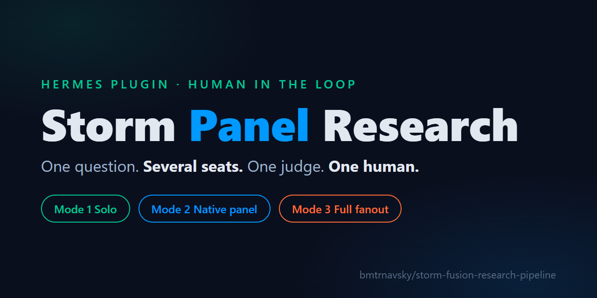
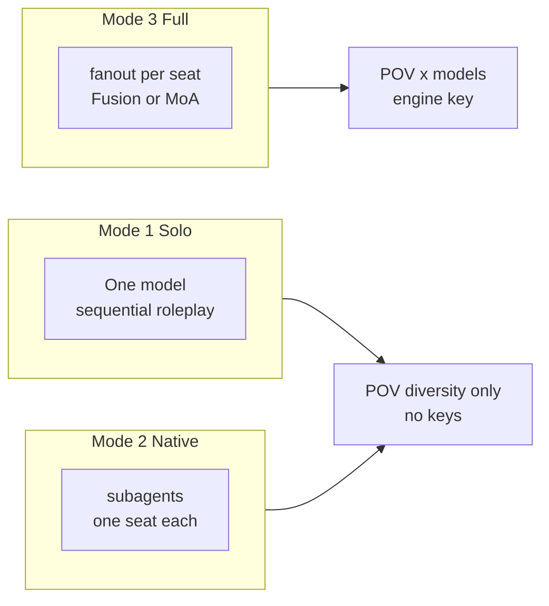
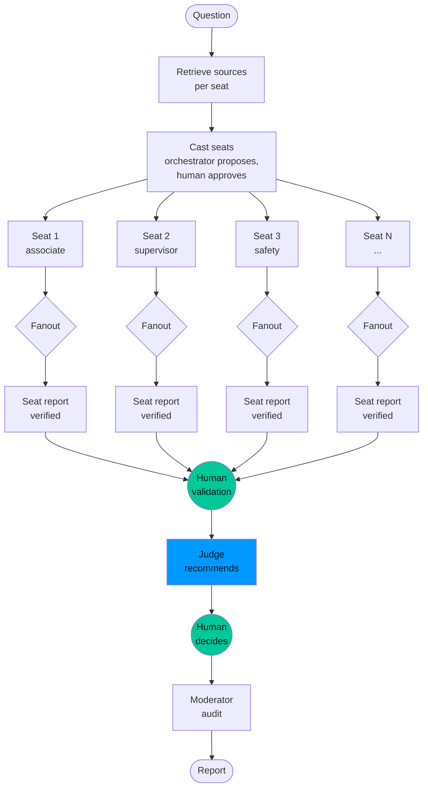

# Storm Panel Research



[](LICENSE)
[](https://hermes-agent.nousresearch.com/docs)
[](CHANGELOG.md)
[](tests)

A human-gated perspective panel: one question, several seats, one judge, one human.
No hardcoded models -- you pick the engine every run.

The panel is grounded. Each seat retrieves its own sources, cites them as `[S#]`, and the
run fails closed when a marker, a URL or a quote does not resolve to a retrieved source.

Inspired by: Shao et al., NAACL 2024 -- "Assisting in Writing Wikipedia-like Articles
from Scratch with Large Language Models". This is not a STORM implementation.

## Install

```bash
hermes plugins install storm-fusion-research
```

The skill loads namespaced as `storm-fusion-research:storm-fusion-research`. Modes 1 and
2 need no keys. Mode 3 needs one fanout engine (OpenRouter Fusion or Hermes MoA) and a
lineup you choose.

One-time consent for per-call model picks:

```yaml
plugins:
  entries:
    storm-fusion-research:
      llm:
        allow_provider_override: true
        allow_model_override: true
        # Optional: limit what the plugin can reach.
        # allowed_providers: [openrouter, moa]
        # allowed_models: ["*"]
```

Hermes MoA slots use presets under the top-level `moa` key, referenced as `provider: moa`
with the preset name as `model`:

```json
{"provider": "moa", "model": "<preset>"}
```

Full procedure: `skills/storm-fusion-research/SKILL.md`.

## Use

Cast the panel, then run it. Two seats on your active model:

```json
{
  "topic": "Should a small DC add a second packing station before peak?",
  "seats": [
    {"name": "associate", "brief": "You pack boxes every shift.",
     "questions": ["Where does packing actually bottleneck?"]},
    {"name": "supervisor", "brief": "You own the shift plan and labor hours.",
     "questions": ["Does a second station pay back in one season?"]}
  ]
}
```

Result: the associate flagged flow and layout, the supervisor ran the capacity math, and
the judge recommended the station only with handoff fixes after validating peak demand.
Seats report, judge weighs, you decide.

Turn on retrieval for the same run:

```bash
export STORM_SEARCH_PROVIDER=searx                       # searx | brave | ddg
export STORM_SEARCH_URL=https://search.example.com       # SearXNG base or Brave endpoint
export STORM_SEARCH_API_KEY=...                          # Brave only
```

`--retrieval auto` (the default) turns retrieval on as soon as a provider is set. Each
seat gets the top `--top-k` sources (default 5), and results are cached on disk
(`.storm-cache`) so a repeated query costs one search.

## What the verifier enforces

Every run with retrieval on is checked before you see it:

- every `[S#]` marker must resolve to a retrieved source;
- every URL in the report must be in the retrieved set;
- every quoted passage must appear in the retrieved text, word-aligned.

A report that fails ends the run with `CitationError` listing each problem. Nothing is
partially accepted and nothing is silently dropped: a marker the model wrote sloppily is
read as a citation attempt and range-checked, so a fabricated source can never read as
"no citation".

The verifier is scored by a closed labeled ledger plus an independent held-out set from
another domain -- zero false positives, zero false negatives, precision and recall 1.0,
both bounds asserted at zero rather than as a tolerance.

## The three modes



| Mode | Seats | Brains | Diversity | Keys |
|------|-------|--------|-----------|------|
| 1 Solo | 2-4 | One model, sequential | POV only | None |
| 2 Native panel | 2-12, parallel subagents | Your model pick | POV only | None |
| 3 Full panel | 2-12, fanout per seat | OpenRouter Fusion or Hermes MoA | POV times models | Engine key |

In mode 3 a lineup slot can itself be a Fusion or MoA call, so the fanout nests: each seat
fans out across the lineup, and each slot can fan out again inside the engine. Cap: 12
seats x 4 slots per run; `--dry-run` prints the plan and the call count. See
`PANEL-SPEC.md` for the cost math.

The orchestrator sizes the panel to the problem: a societal issue gets up to a dozen
seats, a broken deploy gets two (design and engineering). You approve or amend the cast.

## Architecture



Green nodes are human gates. The judge recommends, you decide, the moderator audits.

## How it works

Cast -> retrieve -> interview -> validation -> outline -> draft writing -> moderator
audit. Four gates stay with you: cast, validation, verdict, audit. The judge recommends
with weighted contradictions; you make the call.

## Run it without Hermes

The prompts work anywhere. Paste them into any chat assistant, or run `run_panel.py`
against any OpenAI-compatible endpoint for real multi-model fanout -- standard library
only, `--dry-run` to preview.

```bash
python run_panel.py --dry-run --panel panel.json --model <model>
python run_panel.py --panel panel.json --model <model> --retrieval on --out result.json
```

You pick every model. Per-slot endpoints are opt-in (`--allow-slot-endpoints`, narrowed
with `--allow-endpoint PREFIX`), keys go only to the endpoints they are bound to, and only
`https://` endpoints are accepted. See `docs/use-without-hermes.md`.

Claude Code, Codex, OpenCode, OpenWork, and Pi can all load the skill:
`docs/use-in-other-tools.md`.

## Upstream results (Co-STORM paper, not this repo)

Automatic evaluation on WildSeek with simulated users (Table 3, Jiang et al., Co-STORM,
EMNLP 2024). Scores are rubric means on a 1-5 scale:

| Metric | RAG Chatbot | STORM+QA | Co-STORM |
|--------|-------------|----------|----------|
| Report Relevance | 3.57 | 3.61 | **3.78** |
| Report Breadth | 3.50 | 3.61 | **3.79** |
| Report Depth | 3.26 | 3.43 | **3.77** |
| Report Novelty | 2.44 | 2.50 | **3.05** |
| Unique URLs | 2.94 | 2.89 | **6.04** |

Key finding from the paper: removing the moderator hurts performance more than reducing
the number of experts.

## Implementation Notes

- Reference implementation: [stanford-oval/storm](https://github.com/stanford-oval/storm)
- Mixture of Agents: [Hermes MoA docs](https://hermes-agent.nousresearch.com/docs/user-guide/features/mixture-of-agents)
- This repo: [bmtrnavsky/storm-fusion-research-pipeline](https://github.com/bmtrnavsky/storm-fusion-research-pipeline)

## License

MIT
